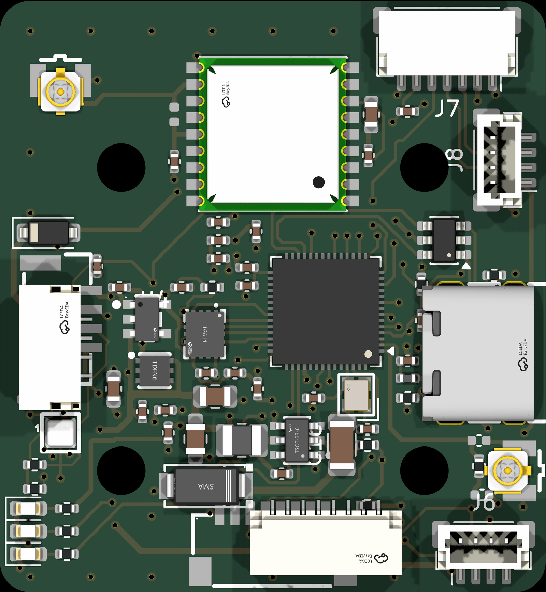

# TAR Team 1 Hardware

Hardware for the Team 1 swarm mapping project (Texas Aerial Robotics, UT Austin).

## Start here

- **Wiring something to the board, or writing firmware for it:** [`docs/hardware-reference.md`](docs/hardware-reference.md) has every connector, pin, voltage and limit on one page.
- **Reading the schematic without KiCad:** [`schematics/network-drone-fc-schematic.pdf`](schematics/network-drone-fc-schematic.pdf).
- **Designing the frame around the board:** [`cad/network-drone-fc.step`](cad/network-drone-fc.step) is the assembled board as a 3D part.
- **Who is doing what:** [`TASKS.md`](TASKS.md) lists each person's tasks and where their work meets someone else's.
- **What one drone is made of and costs:** [`docs/parts-list.md`](docs/parts-list.md) has every part with its maker, a US or European seller, the price, and the total.



## Repository layout

```
TASKS.md                who owns what, task checklists, the charging concept
pcb/
  network-drone-fc/     KiCad 9 project: the board and the schematic source
    lib/                custom symbols, footprints, 3D models
    production/         gerbers, BOM and notes per board revision
schematics/             the schematic as a PDF
cad/                    board 3D model (STEP), board pictures, frame CAD
docs/
  hardware-reference.md every connector, pin, voltage and limit on one page
  parts-list.md         every part: maker, seller, price, stock problems, total cost
  charging-board.md     the charging board: plan, parts, and its 7-pin link to the flight controller
  pcb-test-plan.md      how the board gets checked: before ordering, on the bench, in flight
  frame-test-plan.md    load, drop and vibration tests for the printed frame
  DESIGN.md             design doc: requirements, block diagram, parts, power, layout
  circuits/             how every circuit works and why it's there, box by box
  pin-map.md            ESP32 pin, net name and destination, for firmware
  power-budget.md       current per rail, regulator heat, copper and sag check
  bring-up.md           first power-on checklist
  design-decisions.md   dated log of design decisions
  datasheets.md         links to every datasheet and reference design
tools/
  power_budget.py       the model behind power-budget.md
```

KiCad keeps a project's schematic and board in one folder, so both source files are in `pcb/`. The `schematics/` folder holds the readable PDF.

## Network drone flight controller

KiCad 9 project in [`pcb/network-drone-fc/`](pcb/network-drone-fc/). Open `network-drone-fc.kicad_pro`. The design plan is in [`docs/DESIGN.md`](docs/DESIGN.md).

[View the schematic as a PDF](schematics/network-drone-fc-schematic.pdf) or the board pictures in [`cad/`](cad/) if you don't have KiCad. Regenerate the PDF after schematic changes, from the project folder: `kicad-cli sch export pdf network-drone-fc.kicad_sch -o ../../schematics/network-drone-fc-schematic.pdf`.

- 4-layer board, 36 × 39 mm, four 3.2 mm M3 holes on a 20 × 20 mm pattern so it stacks on a bought 20 × 20 4-in-1 ESC
- Two cable ports for off-board parts: J5 carries 5 V and I2C to the TF-Luna obstacle sensor at the front of the drone, J6 carries 5 V and a UART to the VoCore2 networking module
- All parts on the top side except C35, the bulk capacitor on the bottom, so the top can be reflowed on a hot plate and C35 soldered after with an iron; test points (bare pads) are on the bottom
- Designed for a 2S battery; input stage tolerates up to 4S

Where to buy every part, with prices and each maker's country, is in [`docs/parts-list.md`](docs/parts-list.md). The LCSC numbers in the table below are where the KiCad symbols and footprints were imported from; LCSC is a Chinese distributor, and the parts list gives a DigiKey source for each one.

### Parts in `lib/tar_fc`

Symbols, footprints and 3D models (STEP) pulled from LCSC/EasyEDA. The project's library tables already point at them.

| Function | Part | LCSC |
|---|---|---|
| MCU, bare chip (8 MB flash in package) | ESP32-S3FN8 | C2913196 |
| MCU crystal, 40 MHz ±10 ppm | Q22FA12800101 (2016) | C255898 |
| MCU module (fallback only, not used) | ESP32-S3-MINI-1U-N8 | C2980299 |
| Flight IMU (SPI) | ICM-42688-P | C1850418 |
| Barometer | BMP581 | C5362283 |
| GPS | u-blox MAX-M10S | C4153167 |
| Antenna connector (ESP32 / GPS) | U.FL-R-SMT-1 | C88374 |
| 5 V buck (3.8 to 32 V in) | AP63205WU-7 | C2071056 |
| 3.3 V LDO, digital (WSON-6 with thermal pad) | TLV75733PDRVR | C2868428 |
| 3.3 V LDO, sensors (low noise) | TPS7A2033PDBVR | C2862740 |
| Battery TVS (18 V standoff, safe up to 4S) | SMAJ18A | C908771 |
| GPS bias-T inductor, 27 nH (fit only for an active antenna) | Murata LQG15HS27NJ02D (0402) | C12669 |
| USB 5 V OR-ing diode | B5819W | C8598 |
| USB ESD | USBLC6-2SC6 | C7519 |
| USB-C (USB 2.0, 16-pin) | TYPE-C 16PIN 2MD(073) | C2765186 |
| ESC connector (8-pin JST-SH) | SM08B-SRSS-TB | C160407 |
| Radio port J6 (4-pin JST-SH, top entry) | BM04B-SRSS-TB | C160390 |
| Bulk capacitor on VBAT (C35, bottom side) | Kyocera AVX TCJD107M025R0055E, 100 µF 25 V polymer tantalum, D case | C2159920 |
| Battery capacitor on the ESC's pads, not on this board | 470 µF 35 V low-ESR electrolytic (any of the ones sold for FPV ESCs) | per build |
| Peripheral port (4-pin JST-GH) | SM04B-GHS-TB (LCSC stock low; drop-in alt XY-SM04B-GHS-TB C51940118) | C189895 |
| VDD3P3 filter inductor, 2.0 nH ±0.1 nH, 900 mA | Murata LQG15HS2N0B02D (0402) | C2986275 |

From the stock KiCad libraries (already have 3D models):

- Passives: `Resistor_SMD` / `Capacitor_SMD` 0402
- Buck inductor, 4.7 µH: `Inductor_SMD:L_1008_2520Metric`. It must have a saturation current of 2 A or more now that the sensor and radio ports draw from the 5 V rail; the FTC252010S4R7MBCA (C5832360) listed earlier saturates near 1.1 A and is no longer enough. Check the value against the AP63205 datasheet.
- 6-pin JST-GH: `Connector_JST:JST_GH_SM06B-GHS-TB_1x06-1MP_P1.25mm_Horizontal`
- Mounting holes: `MountingHole:MountingHole_3.2mm_M3` (plain, no copper, courtyard trimmed to the 3 mm keep-out)
- RESET/BOOT pad pairs: `Jumper:SolderJumper-2_P1.3mm_Open_RoundedPad1.0x1.5mm`

### Adding a part

```
pip install easyeda2kicad
python -m easyeda2kicad --full --lcsc_id=C123456 --output pcb/network-drone-fc/lib/tar_fc
```

Then change the new footprint's `model` path to `${KIPRJMOD}/lib/tar_fc.3dshapes/<name>.step` so it works on every machine.
